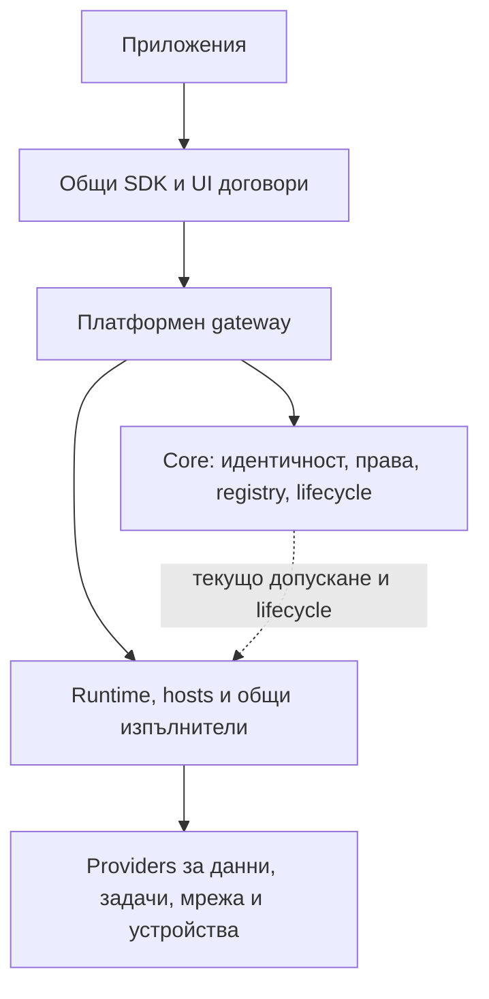

# План за общата основа на Core и приложенията

Обновен: 2026-10-25. Приоритетът остава платформената основа преди
стабилизирането на приложенията. Собственикът уточни, че това е фундаментално
определяне на общите възможности, върху които ще се строят много приложения.
Почистването и наименованията следват тази архитектура.

Целта е малко и устойчиво Core с достатъчно богата платформа около него:
декларирани операции, данни, фонова работа, интерфейс, интеграции и устройства.
Нормалното развитие на приложение трябва да променя неговия пакет или общ
provider, без специална поправка на Core за всеки нов потребителски сценарий.
Нови класове доверие или привилегии могат да изискват целенасочено развитие на
платформения договор; не обещаваме завинаги непроменяемо ядро.

Сегашните приложения, с изключение на Terminal, се приемат като остарели
потребители и източници на изисквания, а не като договори за запазване на стария
SDK. Terminal е актуалният работещ потребител, който пазим при промените.
Не възстановяваме исторически compatibility paths само за да стартираме стари
пакети. Запазваме изходния код, данните и независимия обхват на проектите.

Използвана способност се премахва от Core след като нейният общ заместител е
проверен в избрания платформен профил. Готовността на старо бизнес приложение
не е условие, но липсата му не може да прикрива липсващ основен механизъм.
Изрично оттеглените исторически реализации остават оттеглени; нужният техен
заместител получава нов актуален договор и отделно приемане.

Каталогът по-долу е архитектурно предложение с налична основа, липси и
приоритети. Той не разрешава реализация на всички възможности наведнъж.
Запазваме monorepo и текущите потребителски промени; всяка реализация има
ограничен резултат, точни потребители и подходящи проверки.

## Основа и установени зависимости

Приетите P0–P6 от [плана за стабилизиране](CORE_STABILIZATION_ACTION_PLAN.md)
остават основа. Runtime, application host, Agent, public HTTP и session worker
вече имат отделени процесни или доставни граници в описания там обхват. Не
планираме повторно същото изнасяне. Core все още държи общото допускане на
операции, контролни адаптери, изходящ peer HTTPS и съществуващия M21 broker.

Статичният преглед от 2026-10-24 показа следното; броевете са за тогавашното
работно копие и не са ново измерване след промените от 2026-10-25:

| Наблюдение | Значение за плана |
| --- | --- |
| `backend/main.py` включва AI Builder, AI automations, extension projects, displays и declarative runtime routes | Продуктови функции още са част от състава на Core |
| `backend/database.py` регистрира техните модели и `init_db()` изпълнява `create_all()` | Преместването на HTTP routes няма да отдели собствеността върху данните; трябва миграционен път |
| `backend/routes/settings.py` смесва AI доставчици, менюта, общи настройки и други API | Изнасянето включва настройки и потребители, а не само основните екрани |
| 113 Python файла в `backend/services`, общо 32 430 физически реда; `application_authority_context.py` е 1 296 реда | Плоската структура затруднява ориентацията; това не доказва, че защитните механизми са излишни |
| `AiExtensionBuilder.vue` е 2 680 реда; има отделни `DisplayEditor`, `DashboardList`, `RuntimeExtensionPage` | Функционалните екрани могат да имат собственик приложение |
| Router и compiled UI catalog вече поддържат декларативни entrypoints, audience и permissions | Разширяваме съществуващия механизъм при доказана липса, без втори plugin framework |
| `runtime-contacts` използва действащия declarative CRUD механизъм | Той не е мъртъв само защото старият Python loader е премахнат |
| `Page` и `Extension` още се използват от user/permission/init paths; `Menu` живее в `universal_translation.py` | Старите имена не са достатъчно основание за изтриване; първо отделяме текущите потребители |

Броевете са измерени върху изходните файлове, без тестовете и кешовете, с
включени празни редове и коментари. Те са ориентир за структурата, не измерване
на памет, време за стартиране или обем на действително заредените зависимости.

Прегледът на текущите договори от 2026-10-25 допълва съществените липси:

- `backend/services/module_packages.py` отказва schedules и `kind: job`.
  Старите Child Center и CME descriptors още ги декларират. Това е реална
  разлика между нужда и текуща поддръжка, а не основание да върнем стария Core scheduler.
- Изолираният Public Web договор поддържа GET/HEAD. Съществуващите публични
  JSON операции през Core API не решават сами публичните mutations, guest
  сесиите и webhook ingress на отделния публичен origin.
- Store gap audit посочва липса на общ upload/media договор. Собствени файлове
  и ограничен RPC не са заместител на нормално качване и раздаване на медия.
- Credential-free application UI host вече предлага операции и сесии.
  Presentation API засега публикува `UiSurface`, `UiButton` и `UiDialog`;
  пълният общ набор за forms/tables/uploads още е цел, а не наличен SDK.
- Текущите identity/peer/event/storage/command договори са ценна основа, но
  наличието на admin HTTP endpoint не доказва безопасно делегиран service SDK
  достъп за всяко бъдещо приложение.
- Последните приети retained-data и removal промени пазят cleanup достъп след
  изтриване на пакет. Те са част от общия lifecycle, която запазваме.

Това са изводи от код/договори и текущото WORKING_STATE. Историческите описания
в отделните приложения се използват за нуждите им, без твърдение, че пакетите
днес са съвместими или повторно приети.

## Три слоя на общата платформа

| Слой | Отговорност | Как се разширява |
| --- | --- | --- |
| Core | Идентичност, текущи права, registry на договори/пакети/resources, управление, audit и recovery | Малък набор общи правила за доверие и lifecycle |
| Платформени изпълнители и providers | Application host, Runtime, Agent, tasks, public ingress, streams, file/media обработка и други общи услуги | Декларирани договори, изолирано изпълнение и самостоятелно доставяне при реална нужда |
| SDK и UI инструменти | Типизирани клиенти, общи компоненти, templates, локална разработка, проверки и диагностика | Версирани библиотеки и инструменти извън бизнес логиката на Core |



Платформена възможност не означава задължително код в Core или отделен daemon.
Използваме библиотека, съществуващ Runtime worker или собствен процес според
необходимата зависимост, привилегия и граница на отказ. Приложният Python код
никога не се зарежда в Core, за да регистрира нов provider.

В този план „възможност“ е общ приложен договор. Той е различен от конкретната
device capability, например digital output. Запазваме съществуващия device
registry; свързваме го с общото договаряне, без да смесваме версиите и правата.

## Какво остава в Core

Използваме следния критерий: ако дадена функция е необходима, за да установим
кой може да извърши операция, да управляваме жизнения цикъл на пакет или да
възстановим платформата, тя е платформена отговорност. Нейният изпълнител може
да е отделен процес. Това не я превръща в обикновено потребителско приложение.

| Област | Минимална отговорност на Core | Граница на изпълнението |
| --- | --- | --- |
| Идентичност и достъп | Потребители, сесии, роли, групи, отнемане на права и публична идентичност на инсталацията | Общи правила и текуща проверка; приложение не получава Core signing keys |
| Устройства и providers | Pairing, registry, декларирани capabilities, желано състояние, допускане и проследяване на общи команди | Agent/provider изпълнява локалните задачи и хардуерните действия |
| Пакети и приложения | Manifest v2, проверка, install/enable/disable/update, декларации, UI trust, текущи grants и recovery metadata | Кодът на приложението работи в application host |
| Общи операции | Проверка на service и human authority, scope, поколения, срокове, подписани резултати, idempotency и audit | Runtime/worker извършва изнесеното чакане, мрежа и продължителна работа |
| Общи ресурси | Допускане до файлове, relational resources, secrets, events и connectors | Данните на приложението са отделени; Core пази контрола върху предоставения ресурс |
| Административен интерфейс | Login, устройства, пакети, права, настройки, health и recovery; обща обвивка за навигация и приложения | Vue shell зарежда проверени entrypoints и запазва i18n, теми и Command Palette |
| Поддръжка | Контрол върху update/rollback, backup/restore и ограничена диагностика | Привилегированите и тежките операции използват тесни helpers/workers |

Core трябва да е администрируем без Builder, Automations, Dashboards, Runtime
или работещ диагностичен collector. Липсата на приложение премахва неговите
функции, без да блокира управлението на останалата система.

Минималната диагностика и backup/recovery остават достъпни от администрацията.
По-богати диагностични инструменти могат да станат допълнителен интерфейс, когато
това носи реална независимост. Не изнасяме recovery зад приложение, което може
да е повредено или деинсталирано.

По същия начин общите device registry, OTA trust и безопасното прилагане на
update са платформени. Fleet отчети, групови сценарии и продуктови политики
могат да са приложение върху тези договори. Независимите Fleet и други
application repositories запазват своята уговорена интеграционна граница.

## Какво отделяме от Core

Тази карта определя кои отговорности напускат Core при неговото почистване.
Тя не задава ред за стабилизиране на приложенията преди ядрото.

| Текуща функционалност | Предложен собственик | Какво остава общо |
| --- | --- | --- |
| AI Builder, уточняване, генериране, project files и build history | Приложение **Builder** | Проверка и инсталиране на получен пакет, UI provenance и изрично одобрение от администратора |
| AI provider adapters, настройки за модели, задания, usage и кредити | Потребяващите AI приложения; обща незадължителна библиотека при реално споделяне | Общ secret/connector механизъм; Core не знае имената на AI доставчиците |
| Automation proposals, simulation, revisions, enable/rollback и техният UI | Приложение **Automations** | Проверка на актуални права и общо изпращане/проследяване на допусната команда; локалното изпълнение остава при Agent |
| Табла, widget instances/layouts, редактор, публично представяне | Приложение **Dashboards** | UI entrypoints, общите user/application principals, предоставени ресурси и проверката на публичния audience |
| Declarative CRUD records и готовият contacts пример | Обикновено application приложение; отделен генератор само при реална нужда | Relational/file admission и общото извикване на операции |
| Теми и езици | Съществуващите data packages | Валидатор, lifecycle, безопасни assets, английска възстановителна основа и fallback |
| Бизнес приложения и хардуерни реализации | Съответните приложения и providers | Общи capability/permission договори |
| Старият table/translation engine, старите page/extension paths и останали неподдържани инструменти | Премахване след доказано отделяне на текущите потребители | Не добавяме адаптери само за исторически прототипни версии |

Builder и Automations споделят AI клиенти в текущия код. Отделяме общия
използван код в явна незадължителна зависимост, без копиране. Почистването на
Core приключва след премахването на неговите преки AI зависимости; не чакаме
готов Builder, за да отделим и Automations. Не създаваме отделен AI daemon или
платформа за плащания само заради това споделяне.

`passage.py` съдържа конкретна `access.passage.v1` семантика, но проверява и
собственост, текуща authority, корелация и еднократно приемане на физически
събития. Това е кандидат за отделно обобщаване: общите защитни проверки остават,
а специфичното тълкуване отива при provider/приложението. Не го изтриваме като
„бизнес код“ и не отваряме повторно приетото M20 поведение в първата стъпка.

При declarative CRUD изнасяме общия engine като незадължителна application
зависимост, ако текущите потребители го оправдават. Не генерираме негово копие
за всеки пакет и не оставяме записите на всички приложения в Core базата.

## Договорът между приложение и Core

Използваме текущите manifest v2, application descriptors, SDK, compiled UI и
Runtime transport. Първата задача е да сравним нуждите на изнасяната функция с
наличните операции като част от определянето на Core границата. Списъкът по-долу
е карта на нуждите, не твърдение, че всички
вече са покрити от текущите 25 Runtime операции.

| Нужда | Решение и ограничение |
| --- | --- |
| UI, меню, маршрути и команди | Декларации от пакета, проверка за конфликти, еднакво филтриране в меню/route/Command Palette; текущият сървърен контрол остава задължителен |
| Текущ потребител | Проверен principal и ограничени полета, свързани с точната операция; без прехвърляне на браузърния admin token към приложението |
| Данни и настройки | Собствен ресурс/namespace и собствена schema; публични Core идентификатори вместо директни Core SQL заявки и външни ключове между базите |
| Избор на устройства и capabilities | Ограничен read договор за разрешените ресурси; никаква автоматична глобална видимост заради AI или admin UI |
| Изпращане на действия | Изрично декларирани операции, свежо допускане, human и service права според действието; предложение от AI не е разрешение |
| Генериран пакет | Builder връща артефакт; общият доверен pipeline проверява/компилира/инсталира след изрично действие на администратора |
| Secrets и външен HTTP | Общи secret references и scoped connectors; ограничения за destination, обем, срок и резултат; без произволен достъп до Core secrets |
| Събития и фонова работа | Текущата durable event граница, ограничения и recovery; не възстановяваме оттегления compatibility scheduler |
| Backup/restore | Отделен application snapshot/export и контролирано възстановяване; Core архивът не разчита на познаване на бизнес таблиците |

Когато липсва възможност, необходима за избраната Core граница, добавяме една
обща операция с точни вход, изход, ownership, срок, audit и откази. Проверяваме я
с текущите референтни пакети и засегнатите потребители. Специфичните бъдещи
нужди на приложенията остават за техния етап. Не изграждаме целия бъдещ SDK
предварително и не добавяме endpoint с име на конкретно приложение.

Automation deployment например днес използва вътрешно `queue_command` с
`automation.apply/remove`. Това не доказва, че SDK `command.submit` може да
замести същия път: той използва декларирани capability bindings. Преди изнасянето
определяме общия договор за управление на workload/provider, актуализираме
засегнатите текущи потребители и запазваме approval, expiry и no-replay поведението.

Промяна на service ресурс не трябва да дава на непозволен човек правата на
приложението. Отнемане на сесия, блокиране на user, disable на приложение,
промяна на пакет или binding трябва да се отразяват на съответната операция.
Core outage не разрешава нови привилегировани действия.

UI компилацията е отделна build отговорност от сървъра за управление. Запазваме
проверката на точния source/build и доверения installation pipeline. Ако Node
още се стартира от Core при install, евентуалното му изнасяне е отделен scoped
worker резултат с ограничения и failure checks, а не странично преименуване.

## Каталог на общите възможности

Всяка област описва целевия договор. „Налична основа“ означава намерен код или
договор в конкретен профил, без ново твърдение за пълно runtime/live приемане.
Пълният сценарий и актуалното покритие се записват при избора на реализация.

### CAP01 Откриване на договори и свързване с provider

Налична основа: schema catalog, signed platform discovery и device capability
registry. Липсва единна приложна картина за всички услуги и техните зависимости.

- Приложението декларира нужни и незадължителни договори, версии и профили.
- Registry различава „поддържа се“, „има инсталиран provider“, „работи“ и
  „разрешено е за този потребител и приложение“.
- Логически binding избира точната provider instance/resource; няма търсене
  по предположено име на приложение, filesystem path или частен URL.
- Смяна на provider или договор се валидира преди activation; липсваща
  незадължителна функция дава конкретно degraded състояние.

### CAP02 Идентичности и делегирани права

Налична основа: user/session/role/group, application grants, kiosk и machine
principals, M20 service resource authority. Нужно е последователно приложно API.

- Проверен actor за всяка операция: човек, kiosk, guest, приложение, worker
  или друга инсталация; payload не може да избира доверената идентичност.
- Разрешения за операции и resources с независими human и service права,
  ясни effective permissions и текущо отнемане при блокиране/disable.
- Делегирано действие пази инициатор и изпълнител, точен обхват и срок;
  service account не превръща непозволен човек в администратор.
- Platform admin и business admin са отделни понятия. Организации,
  членства, клиентски роли и ACL на бизнес записи остават при приложението.

Сегашният coarse admin bypass е ограничение за преглед, а не готов договор
за автоматичен достъп до всички клиентски данни. Същият login не означава
еднакви customer права във всички приложения или всички инсталации.

### CAP03 Пакети и жизнен цикъл

Налична основа: manifest v2, проверка, review, activation, update, rollback,
recovery, uninstall и retained-data cleanup. Общото dependency планиране се доуточнява.

- Preview на нужните договори, ресурси, зависимости и ефекти преди install.
- Изрично prepare/activate/disable/update/rollback с readiness и recovery
  състояния; artifact version е отделен от schema/resource поколението.
- Изключването пази данните; uninstall, retirement на пакет и erasure са
  различни действия. Данните остават откриваеми и след последния изтрит пакет.
- Lifecycle hooks са ограничени операции в host, с deadline и receipt;
  старт на приложение не трябва да блокира Core администрацията.

### CAP04 Операции и проследим резултат

Налична основа: schema-bound query/command, trusted OperationContext,
idempotency контекст и семейства с durable receipts. Нужен е общ последователен модел.

- Типизирани input/output/error schemas, ограничен payload и точен audience.
- Устойчив operation ID, status/result и ясни „не е изпратено“, „прието“,
  „потвърдено“, „непотвърден външен резултат“; HTTP timeout не е rollback.
- Еднакъв idempotency key с различен payload се отказва. Receipt lookup не
  изпълнява отново действието и не предоставя нови права.
- Кратките заявки връщат резултат; продължителните връщат handle и използват
  общата task граница. Отмяна не обещава връщане на вече извършен външен ефект.

### CAP05 Собствени данни и транзакции

Налична основа: application-owned SQLite, migrations/outbox и scoped relational
механизми с конкретни профили. Това не е готова универсална multi-database услуга.

- Изолирана persistent namespace за всяка логическа application instance,
  предоставена през SDK без Core DB credentials или клиентски host paths.
- Транзакции, revision/CAS, migrations и контролирани snapshot/restore;
  процесното рестартиране не сменя собственика на данните.
- Query pagination, bounded results и import/export helpers; индекси,
  relations, бизнес validation и модели са собственост на приложението.
- App-owned transaction може атомарно да запише domain промяна и outbox запис.
  Последващото изпращане е отделно; не обещаваме обща SQL транзакция с Core
  или exactly-once външен ефект.

### CAP06 Настройки и secrets

Налична основа: manifest configuration/bindings, собствени application settings,
secret references и connector broker. Нужно е ясно разделение и единен UI/SDK достъп.

- Schema/defaults/validation и revisions за platform binding/configuration.
- App-wide и user preferences чрез общ helper; бизнес настройки се пазят
  в приложението и не се превръщат в глобални Core setting keys.
- Secret reference с owner, purpose, credential kind и разрешени consumers;
  rotation/revocation не изискват secret в пакет, UI или логове.
- Секрет се използва от допуснат executor/provider. Общото API не е
  „прочети произволен Core secret“, а право за конкретна употреба.

### CAP07 Събития и надеждна доставка

Налична основа: device events, application publication, durable delivery,
checkpoints и application outbox. Общ cross-application обмен изисква допълнителен договор.

- Версирано събитие с устойчив ID, проверен producer и ограничен payload.
- Декларирани subscriptions с filtering, offset/checkpoint, дедупликация,
  backpressure, retry budget и състояние за операторска reconciliation.
- SDK bridge между committed application outbox и Runtime delivery; crash
  след локален commit не губи приетата работа.
- Cross-app subscription получава отделен grant за точни типове/полета/consumer;
  публикувано събитие не става автоматично видимо за всички приложения.

Не използваме SDK call вътре в активна relational транзакция като фиктивен
атомарен commit. Бизнес consumer трябва да понася повторно доставено събитие.

### CAP08 Фонови задачи и време

Текуща липса: поддържан scoped scheduler няма; schedules и `kind: job` са
изрично отказвани. Новият механизъм е необходима обща способност, с изпълнение
извън Core и нов ресурсен/admission договор, без връщане на стария compatibility loop.

- Еднократна отложена задача, interval и календарно разписание с timezone;
  ясни DST, пропуснат срок и catch-up правила без внезапен burst.
- Durable task ID, claim/lease и поколения, ограничен concurrency,
  singleton при нужда, deadline, progress, cancellation и result lookup.
- Retry само при доказано безопасна фаза или деклариран идемпотентен договор;
  непотвърден външен ефект остава за reconciliation, без сляпо повторение.
- Текущи права преди започване и следващ привилегирован ефект; restart,
  disable, upgrade и worker loss имат определено поведение.

Retention, отчет, reminder и външна доставка използват същия изпълнител.
Какво значи „одобри“, „плати“, „затвори посещение“ и какво следва след това
остава в приложението или споделена незадължителна workflow библиотека.

### CAP09 Общ интерфейс и browser SDK

Налична основа: compiled UI, credential-free operation/session host, navigation,
i18n/themes и три public presentation компонента. Нужен е по-богат стабилен UI toolkit.

- Меню, routes, вложена навигация, Command Palette и проверени deep links
  се регистрират декларативно и изчезват при disable.
- Общи forms/fields, validation, tables/pagination, filters, dialogs,
  status/error/empty/loading състояния, file picker и task progress.
- Приложението ползва `invoke`, разрешените bindings, текущ actor/permission
  context и locale/timezone чрез host, без tokens или private Core imports.
- Responsive и достъпен интерфейс, теми и localization; widget/editor slots
  имат общ договор, а dashboard layouts и бизнес екрани са приложение.

Reviewed code в общ browser origin не е hostile-code sandbox. Ако е нужен
недоверен frontend, той получава отделен isolation профил, а не обещание от UI helper.

### CAP10 Публични страници и публични сесии

Налична основа: отделен Public Web GET/HEAD и публични application queries.
Нужен е договор за mutations/session ingress на изолирания публичен origin.

- Декларирани host/surface/routes, cache и bounded responses без достъп
  до Core administrative namespace или доверие само по Host header.
- Public command/form submit със schema, operation identity, лимити и
  origin/CSRF защита според избрания credential/session модел.
- Ограничен guest context с expiry; customer login, ако се изисква,
  използва изрично предоставен identity договор без platform admin права.
- Source-aware abuse limits и доверена proxy/client metadata; TLS/domain
  binding и външен ingress се конфигурират изрично.

Cart/session/checkout политиката е на приложението. Сигурният публичен
transport и credential lifecycle са общи, ако продуктът има нужда от тях.

### CAP11 Файлове и медия

Налична основа: собствени файлове и bounded scoped file операции. Липсва
общ upload/download/media договор извън малкия JSON/RPC payload.

- Bounded upload stream, временна upload identity, chunk/resume при нужда,
  checksum, atomic finalize и почистване на недовършените uploads.
- Owner/namespace, byte/count quotas, content metadata, lifecycle и
  отделни private/public permissions; няма произволен filesystem path.
- Download/preview и ограничена public asset връзка с точен срок/собственик;
  revoke и uninstall/retained-data правилата важат и за медията.
- Thumbnail, resize, format conversion и други тежки transforms са
  незадължителни workers/providers; оригиналът и derivatives са проследими.

Една и съща възможност служи за продуктова снимка, документ, attachment или
експорт. Данните не минават като неограничен base64 през operation gateway.

### CAP12 Външна мрежа и webhooks

Налична основа: declared outbound connectors, secret broker и отделен network
worker. Общият вход за външни callbacks/webhooks е допълнителна способност.

- Scoped outbound request към одобрен destination/method с deadline,
  byte/concurrency лимити и credential reference; без произволна proxy услуга.
- Operation receipt, correlation и разграничение между safe retry и
  непотвърден mutation; provider rate limits не блокират Core threads.
- Деклариран webhook route на публичната повърхност, bounded raw bytes,
  signature/challenge проверка от подходящ verifier и replay/dedupe политика.
- Durable приемане преди acknowledgement и предаване към разрешения
  application consumer, с ясни expiry/disable/key-rotation състояния.

Vendor API, платежен статус, куриер, POS mapping и отговорът на domain ниво
остават в connector/application implementation извън Core.

### CAP13 Композиция между приложения

Налична основа: общ gateway и descriptors за собствените application операции.
Общ service-to-service operation binding не е доказан като налична пълна възможност.

- Provider публикува версиран contract, consumer декларира зависимост;
  администраторът свързва точните instances/operations/resources.
- Invocation използва проверен caller и при нужда ограничено делегиране
  на инициатора; няма общ admin token или достъп до чужда база.
- Стандартни opaque entity references и deep links, ownership и unavailable
  състояние; Core не научава моделите на свързаните бизнес обекти.
- Version mismatch, цикли, fan-out и cascading failure са ограничени;
  revoke/disable прекъсва новото допускане към binding.

Това позволява отделни документи, известия, отчети или други общи providers
да обслужват много приложения без Core branch за всяка двойка.

### CAP14 Устройства и локални workloads

Налична основа: pairing, provider-aware registry, state, commands, Agent modules
и Node update workflow. Admin HTTP достъпът се различава от делегиран application SDK.

- Разрешено откриване на устройства/capabilities/contracts и отделни
  availability, freshness и permission състояния.
- Точни command bindings с аргументи, ограничения, срок, status/receipt
  и no-replay при неясен физически резултат.
- Общ lifecycle за workload/configuration/module с preview, explicit approval,
  ревизии и reconciliation; приложението не ползва SSH или частни Core функции.
- Локална safe/offline policy за вече приета работа; telemetry subscriptions
  и историческо съхранение се предоставят от подходящ provider, без вечен raw
  telemetry архив в Core DB.

GPIO, serial, MQTT, скенер, принтер и бъдещ хардуер се реализират като providers
с точни ресурси/профили. Нито търговската марка, нито типът бизнес приложение
определят Core маршрут.

### CAP15 Сесии и потоци

Налична основа: общ Session SDK/browser host и приетият ограничен Terminal
профил; текущият common Node/relay gate има точния обхват в WORKING_STATE.

- Discovery, open, двупосочни данни, независим output, control, close и
  backpressure през един разрешен binding.
- Отделни read/write/control права, размери на frames/buffers, lifetime и
  текуща проверка при startup/output/операции.
- Link loss, revoke, unknown startup и cleanup се разрешават с доказателства
  за притежавания worker; input не се преизпраща автоматично.
- Log tail, serial console или други stream providers използват договорни
  профили; audio/video и host administration не се обявяват за поддържани
  само защото byte stream работи.

Terminal остава живата проверка на тази граница и запазва независимостта си
от Fleet/CME. Нови API промени актуализират засегнатия текущ потребител заедно.

### CAP16 Междуинсталационен обмен и offline поведение

Налична основа: installation identity, peer enrollment/consent/status projection,
Agent offline journals и ограничени remote session transport профили.

- Проверена identity, точен remote origin, двустранно enrollment/consent,
  scope, generation, rotate/revoke и audit.
- Изрично разрешени reports/events/operations със собствен contract;
  текущият status-report договор не е разрешение за remote administration.
- Durable outbox, sequence/checkpoint, bounded backlog и ясно
  online/stale/offline/unknown; reconnect не съживява стари права.
- Data sync/conflict resolution е политика на приложението или отделен
  provider; не добавяме глобална distributed transaction или скрито sharing.

Core outage не дава нови привилегии. Продължаването на локална задача
изисква предварително определена safe policy за нейния профил.

### CAP17 Известия

Общ изпълним notification договор не е установен в прегледаните SDK exports.
Наличието на notification модел само по себе си не доказва delivery услуга.

- In-app inbox с owner/audience, read/ack/dismiss, expiry, dedupe и quota.
- Задачи за отложено известяване и retries с видим delivery status.
- Email/SMS/push са сменяеми channel providers с credential references;
  Core не съдържа конкретни доставчици или бизнес текстове.
- Recipient consent/preferences, rate budgets, localization и redaction;
  шаблонът и причината за известието са на приложението.

### CAP18 Търсене и документи

Целеви незадължителни providers и SDK helpers; Command Palette за навигация
не е пълнотекстов индекс на application данните.

- App-owned indexes или scoped search provider с filtering, pagination,
  version/reindex и изтриване при retention; резултатите спазват текущия достъп.
- Общи CSV/JSON import/export helpers с preview, validation и progress,
  без Core да знае бизнес колоните.
- PDF/табличен отчет или image rendering чрез ограничена task/worker
  операция; templates, изчисления и бизнес съдържание са извън Core.
- При cross-app търсене всеки provider прилага своя ACL; няма централен
  индекс, който разкрива чужди records само заради login.

### CAP19 Одит диагностика и възстановяване

Налична основа: audit, bounded opt-in diagnostics, component status,
backup/restore и recovery. Нужно е последователно application-level обслужване.

- Общи correlation IDs през UI, operation, event, task и device command;
  structured errors отделят operational отказ от domain validation.
- Ограничени health/metrics/diagnostics и metadata audit на реалния actor,
  без passwords, tokens и произволни business payloads в общите логове.
- Проверени application snapshots, schema/version/identity metadata,
  restore/upgrade rollback и retained-data cleanup независимо от работещия app.
- Приложението предоставя personal-data export/erasure/retention операции;
  платформата осигурява ресурсите, правата и задачите. Външни копия не се
  обявяват за изтрити само след локален DELETE.

### CAP20 Изолация и ресурсни профили

Налична основа: отделни процеси/principals/artifacts и проверени systemd
ограничения в конкретни профили. Reviewed-native не означава универсален sandbox.

- Декларирани CPU/RAM/process/FD/concurrency/time/network/storage бюджети,
  с ясно „OS enforced“, „SDK cooperative“ или „unsupported“ за всяка граница.
- Работа само с предоставени data/resources; Core keys/DB и чужди приложения
  не са нормален execution context.
- Bounded restart/backoff/quarantine и degraded feature; optional worker
  не управлява Core readiness и не причинява неконтролирано изчерпване.
- Linux PC, Raspberry full и minimal Node имат реално проверени профили;
  липсващ ресурс не се представя като предоставен или безкраен.

### CAP21 Разработка и автоматизирано изграждане

Налична основа: SDK, protocol schemas, compiler, package inspection,
reference packages и изолирана dev лаборатория. Нужен е един последователен authoring цикъл.

- Машинно четим semantic catalog: operations, schemas, errors, права,
  граници, профили и lifecycle, плюс авторитетна package/runtime validation.
- Templates за app service/UI/data/tasks/providers и типизирани клиенти,
  използващи само публичните договори.
- Локално изпълнение с mock bindings, migration checks, denial/revoke/fault
  scenarios и conformance проверки преди install.
- Build/install/update на един пакет без Core release; Builder/AI инструмент
  използва същите schemas и pipeline, без тайно разрешение за install или effect.

Structure-only JSON Schema не замества semantic validation или право за
изпълнение. Непознат required договор отказва activation с разбираема причина.

## Задължителен опис на всеки договор

За всяка избрана CAP възможност попълваме следното преди runtime реализация.
Идентификаторите CAP01–CAP21 са точки в плана, не нови wire IDs или версии.

| Поле | Какво трябва да е определено |
| --- | --- |
| Идентичност и версия | Contract ID/owner, semantic schema и отделни version axes; текущ потребител и provider |
| Предоставяне | Core правило, Runtime worker, Agent/provider или SDK helper; supported device profiles |
| Декларация | Required/optional зависимост, requested resources, limits и текуща наличност |
| Binding и доверие | Кой свързва exact instances/resources, как се проверява provider и кога се прекратява binding |
| Actor и права | Human/service/machine/guest context, app/domain ACL граница, admission и revoke правила |
| Данни | Собственик, namespace, чувствителни полета, retention, migration/export/erase и backup |
| Операции | Input/output/error schemas, stable IDs, paging/streaming, progress/status/cancel |
| Надеждност | Commit point, dedupe/idempotency, retry и unknown semantics, crash/restart/offline поведение |
| Ресурси | Измерими size/time/rate/concurrency/storage budgets и реален enforcement |
| Lifecycle | Install/disable/upgrade/rollback/uninstall, смяна на ключ/provider/поколение |
| Проверки | Neutral consumer, втори различен сценарий, denial/revoke/isolation и failure/recovery доказателства |
| Разработка | Public SDK/UI entrypoint, local mock, пример и authoring validation без private imports |

Публичният API на една бизнес библиотека сам по себе си не е платформена
способност. В Core влизат общите правила за доверие и ресурси. Бизнес шаблони,
workflow definitions, модели, доставчици и алгоритми живеят в приложения,
providers или незадължителни споделени библиотеки.

## Проверка с различни бъдещи приложения

Старите приложения дават нуждите, но не диктуват старите реализации.
Приемането използва малки неутрални сценарии и Terminal като актуален потребител.

| Семейство приложения | Нужни общи способности | Какво остава извън Core |
| --- | --- | --- |
| Terminal, log viewer, serial console | CAP02/03/04/09/14/15/19/20 | Renderer, protocol/provider implementation и разрешен execution profile |
| Център, рецепция, CRM, посещения | CAP02/04/05/07/08/09/11/12/14/17/19 | Клиенти, престои, цени, плащания, специфични retention и интеграционни правила |
| Магазин, каталог, резервации | CAP04/05/08/09/10/11/12/17/18/19 | Каталог, количка, наличност, checkout, availability и vendor mappings |
| Fleet, monitoring и управление на workloads | CAP01/02/03/04/07/08/09/14/15/19/20 | Групови изгледи, графики, продуктови политики и сценарии за масови действия |
| Cloud portal и споделяне | CAP02/04/05/07/08/09/13/16/17/19 | Организации, ownership, членства, покани и business consent/ACL |
| Builder, Dashboards и бъдещи editors | CAP01/03/04/05/06/09/11/13/18/21 | Генериране, layout, templates и продуктова логика |

Потребител може да комбинира тези способности в ново приложение без
регистрация на нов конкретен business type в Core. Нуждата от нов hardware
driver, канал за известяване или renderer обикновено означава нов provider,
а не нов Core endpoint.

## Профили и приоритети за изграждане

Каталогът е по-широк от първата реализация. Описваме целия договорен обхват,
а изпълнението е на малки проверими резултати в следните профили:

| Профил | Приоритетни способности | Условие за използване |
| --- | --- | --- |
| Общ application профил | CAP01–CAP09 и приложимите CAP19–CAP21 | Първа основа: identities/grants, lifecycle, invoke, own data/config, events/outbox, minimal tasks и UI host; наследяваме наличното, реализираме само липсите |
| Public application профил | CAP10–CAP12 плюс общата основа | Форми, guest/customer context, webhooks и uploads имат проверен общ път преди приложение да обещае тези функции |
| Connected и device профил | CAP13–CAP16 плюс общата основа | Scoped composition/device workload и stream/offline поведение са доказани за избрания локален/remote профил |
| Допълнителни providers | CAP17–CAP18, media transforms, по-богати UI/dev helpers | Добавят се според избран реален сценарий; отсъствието им е явно, без да блокира минималната администрация |

За всеки профил различаваме „договорът е описан“, „има работещ executor“,
„има conformance доказателства“ и „приет е на целевата среда“. Required
функция от отсъстващ профил не се имитира с compatibility fallback.

Ранните доказани липси за дизайн са CAP08 tasks, CAP11 upload/media, CAP10
public mutation/session ingress, CAP13 composition и делегираният достъп в
CAP02/CAP14. Те не са една обща implementation задача. Първо затваряме
договорите на общия профил и избираме един ограничен липсващ механизъм.

## Наименования и структура

Запазваме monorepo и настоящите основни директории. Имената и групирането следват
избраните договори и собственици от каталога; rename вече не е първият самостоятелен
резултат. Изпълняваме source промените по една област с обновени imports,
регистрации, потребители и build/deployment входове. Отделна директория `apps/`,
дублираща `modules/`, не е необходима.

Термините имат различни значения:

| Термин | Значение |
| --- | --- |
| Package / пакет | Неизменяемата инсталационна единица с manifest v2 |
| Application / приложение | Пакет с потребителски функции и евентуално собствен service/data |
| Provider / доставчик на capability | Реализация на декларирана възможност |
| Platform component | Core, Runtime, application host, Agent или helper с отделна системна отговорност |
| Theme / language package | Данни и assets по общ договор; не обикновен изпълним backend |

В интерфейса използваме „Приложения“ за приложенията и „Пакети“ за общото
управление на приложения, device modules, езици и теми. Не преименуваме всички
`module_id` или descriptors само за да съвпаднат с UI етикетите.

Предложената вътрешна структура на Core е:

```text
backend/
  main.py                        # composition, middleware, lifespan, router wiring
  config.py
  database.py                    # един вход към Core DB
  identity/                      # users, sessions, roles, groups
    api.py
    models.py
    schemas.py
    access.py
  devices/
    api.py
    models.py
    registry.py
    commands.py
    capabilities.py
  applications/
    api.py
    contracts.py                   # catalog и версии на общите application договори
    bindings.py                    # exact consumer/provider/resource връзки
    packages.py
    lifecycle.py
    gateway.py
    authority/
      context.py
      policy.py
      grants.py
      review.py
      keys.py
    resources/                   # общ контрол за relational/files/secrets
    sessions/                    # текущата обща граница, при собствен отделен scope
  system/
    settings.py
    updates.py
    backups.py
    diagnostics.py
    recovery.py
  infrastructure/                # само доказано общи технически механизми
    sockets.py
    storage.py
  alembic/                       # съществуващата миграционна история
  tests/
```

Това е карта на собствеността, не задължителен брой файлове. Малка област може
да е един файл; голяма може да има няколко API файла. Не добавяме автоматично
слоеве repository/service/facade за всяка функция. Чистите общи договори
остават извън backend в protocol/wire пакетите; не ги скриваме в infrastructure.

Примери за по-ясни имена, когато съответната област бъде преместена:

- `services/application_authority_policy.py` → `applications/authority/policy.py`;
- `services/application_authority_management.py` → `applications/authority/grants.py`;
- `routes/device_commands.py` и свързаната логика → областта `devices`;
- `ApplicationExtensionInstallation` → `ApplicationInstallation` при scoped
  преглед на текущите потребители; Python име и SQL таблица не се преименуват неявно;
- `backend/db/menu.py` става реалният собственик на меню модела, когато отделим
  текущия `Menu` от старите translation таблици.

`three_mm_platform_runtime` е достатъчно точно име за отделния SDK/relay Runtime.
`three_mm_runtime` обаче смесва application host, управление на relational
resources, update helpers и setup/recovery. Доставните граници вече са частично
отделени чрез явни file lists. При Core картата определяме дали разделянето
на `three_mm_application_host` и `three_mm_system` е необходимо за ясната обща
граница; session worker запазва собствената си доставна граница. Ако го включим
в Core етапа, обновяваме всички systemd entrypoints, builder allowlists, native
artifacts и installers заедно. Не го обвързваме с готовността на приложенията
и не добавяме временни import aliases за исторически версии.

`three_mm_platform_wire` запазва stdlib границата си. Обединяването му с
Pydantic protocol моделите би върнало зависимости в компоненти, които сега
не ги изискват. Версиите на manifest, SDK, wire и private ABI остават независими.

За всяко приложение използваме съществуващата форма на package source:

```text
modules/builder/                  # аналогично automations и dashboards
  manifest.json
  application-extension.json      # когато пакетът има service
  compiled-ui.json               # когато има compiled UI
  service/
    builder_app/
      service.py
      projects.py
      providers.py
  source/frontend/
    Builder.vue
    components/
  locales/                       # според действащия language/UI договор
  tests/
  README.md
```

Имената на descriptor файловете следват актуалните публични договори. Wheels,
ZIP и frontend build outputs са артефакти, а не второ копие на изходния код.
Реалните application sources могат да са в отделните съществуващи repositories;
тази карта не премества независимо разработвани приложения в Core monorepo.

Във frontend групираме администрацията като `app` за shell/router/bootstrap,
`features` за identity/devices/packages/system и `platform` за application host,
catalog, navigation, i18n и теми. Самите Builder/Automations/Dashboards екрани
напускат Core frontend. Запазваме Vue 3, TypeScript, Vite, Pinia и Vue Router.

Tasks, media, notification и други изпълнители са извън това Core дърво.
Библиотеки и съществуващи Runtime workers се използват, когато дават нужната
граница; не създаваме отделен пакет или процес за всяка точка от каталога.
Разширеният SDK се подрежда по договорни семейства, вместо всички клиенти да
растат в един `__init__.py`. Съществуващите работещи entrypoints на Terminal
се променят само заедно с неговите засегнати потребители и проверки.

## Последователност

Всяка стъпка завършва с работещо състояние и кратък запис в WORKING_STATE.
Следващата започва при изпълнени критерии за завършване на предишния резултат.
C0–C5 изграждат и приемат общата платформена основа за избрания профил.
Стабилизирането или повторното изграждане на конкретните приложения е след това.

| Стъпка | Работа | Условие за завършване |
| --- | --- | --- |
| C0 Каталог и покритие | CAP01–CAP21, app requirements, налично/частично/липсващо, собственици и профили; този документ е началната карта | За всяка избрана способност има потребители и профил, а за използвана оттегляна функция — конкретен общ заместител |
| C1 Точни договори и имена | Попълваме задължителния опис за началния application профил, actor/resource/binding модела и първата липсваща способност; определяме source mapping | Входове/изходи, права, budgets, crash/revoke/recovery, SDK entrypoints и acceptance сценарии са достатъчно точни за реализация |
| C2 Общи липсващи механизми | По един bounded резултат: преизползване на наличното и реализация на избраните липси в Runtime/provider/SDK, без бизнес branches | Всеки механизъм е доказан с neutral consumers и текущи права; не е само описан descriptor или празен интерфейс |
| C3 Почистване и преструктуриране на Core | Реални имена/domain grouping, премахване на остарели/дублирани paths и приложни зависимости от boot/API/DB/frontend след проверен заместител | Един актуален общ път; запазени app sources/data и Terminal; няма второ compatibility дърво или загубена обща способност |
| C4 Композиция и fault проверки | Съчетаваме capabilities през различни neutral сценарии; проверяваме claims/receipts, profile budgets, lifecycle, provider failure и зависимостите | Добавяне на втори provider/consumer в поддържаното семейство не изисква конкретно име или нов специален код в Core |
| C5 Приемане на платформената основа | Минимална администрация без optional услуги плюс реални общи сценарии на избрания профил, Terminal regression, migration/rollback и приложимите Linux/ARM проверки | Устойчиво Core и достатъчна изпълнима основа за следващите приложения; останалите профили и ограничения са явно отбелязани |
| A1 Актуални приложения | Изграждаме/обновяваме по едно приложение върху приетите договори с неговите domain модели, UI, migration и потребителски сценарии | Ново нормално business поведение се реализира в приложението/provider; няма запазване на стар SDK само заради остарял пакет |

Следващият предложен ограничен резултат е C1 за CAP08: точен scoped task/schedule
договор върху текущите CAP02/04/05/07 механизми. Той адресира доказана липса за
различни приложения и retention/delivery сценарии. Първо се фиксират admission,
claim/lease, operation identity, deadlines, retry/unknown и lifecycle; после
се реализира един neutral scheduled consumer в отделния executor. Не се
възстановява старият scheduler и не се започва масово преименуване.

C1–C4 се изпълняват на малки завършени промени. Не изграждаме всички optional
профили преди първия резултат и не разширяваме автоматично приетите M20/P0–P6
и common-session граници. За промяна в засегнат security/runtime договор
проверяваме действителните текущи потребители; старите отчети не са нова опашка.

При C3 отделяме dependencies за изпълнение от dependencies, които общият
installer използва за първоначално изграждане на компонентите. Например
`gpiod` има Agent hardware потребител, а `httpx` има peer потребител в Core:
изнасянето на AI не е основание да премахнем и двете от общата доставка.
Променяме конкретния lock/artifact closure след преглед на неговите потребители.

Core остава един вътрешно подреден процес за управление. Не добавяме отделна
услуга за всеки негов пакет. Приложенията използват съществуващите host граници
и получават бюджети според целевото устройство; минималният Node профил не
получава Core приложения заради това преструктуриране.

### Практическо начало на Core етапа

Началната карта вече обхваща Core composition/database/settings, публичните
protocol/SDK/UI договори и изискванията на отделните app проекти. Точните
изпълними schemas и ресурси се доуточняват само за избраната способност.
Имената и файловата структура следват това решение.

За всяка област записваме стария и новия път, отговорността, текущите consumers,
нужните migration/deployment промени и проверките. Механичното преименуване
запазва поведението. Промяна в права, schema или общ API се отчита изрично
и получава съответните проверки, вместо да се прикрива като rename.

При C3 провереният общ заместител е входно условие за премахване на използвана
способност. Приложните sources се отделят за последващото им довършване. Заедно
премахваме преките Core imports, routes, автоматични model регистрации,
frontend imports и build зависимости. Старите данни остават възстановими по
описания миграционен план. Скрито меню или feature flag с останала активна
зависимост не изпълнява критерия.

Критичните сценарии за C5 включват както администриране без optional workers,
така и цялата избрана capability верига. Например запис + outbox + фонова
доставка след restart, или два consumers на един разрешен provider. При
приемане на public профила добавяме публична форма/upload с правилна identity
и isolation. Генерирането с Builder, редактирането на бизнес табла и пълните
продуктови automation сценарии принадлежат на A1.

## Миграция и връщане назад

За всяка изнасяна област първо определяме собствеността на данните. Core пази
идентичности и grants; приложението пази своите проекти, layouts, proposals или
records. Използваме предоставените relational/file ресурси, без да даваме на
приложението Core DB credentials или достъп до Core таблиците.

Миграцията има следния ред:

1. Инвентар на редове, идентификатори, собственост, grants, настройки, артефакти
   и препратки; изрично решение какво е историческо и какво е активно.
2. Backup и export със schema/version и digest; пробно преобразуване в отделни
   данни с проверка на брой, съдържание и права.
3. Контролиран прозорец без записи в засегнатата функция; последен export,
   import и проверка. Не добавяме дългосрочен dual-write режим.
4. Един активен собственик и пренасочване на текущите потребители; без втори
   работещ legacy API след завършената стъпка.
5. Проверен rollback: съвместим обратен export/import или snapshot restore с
   ясна граница за последващите записи. Смяна на release symlink сама по себе
   си не връща променена schema или нови application данни.
6. Премахване на старите models, imports и таблици чрез явна migration, след
   като приложимият сценарий за възстановяване е проверен.

`create_all()` не премахва стари таблици. Отделянето изисква явни migrations и
съгласуване на startup с migration authority; проверката на незасегнатото Core
състояние остава задължителна. Clean reset е възможен само като отделно избран
и ограничен план. Този документ не заявява reset на устройства или бази.

За grants определяме mapping към точната application instance и resource.
Не превръщаме dashboard view права в общи application admin права. При изтриване
или блокиране на потребител запазваме отказа на достъп, правилата за запазване
на данните и липсата на препратки, които Core трябва да чисти чрез application SQL.

## Проверки и измерим резултат

Изборът следва [DEVELOPMENT_CHECKS.md](DEVELOPMENT_CHECKS.md). За този план се
проверяват текст, diff и връзки. При реализация използваме засегнатите checks,
а при общ auth/SDK/schema/runtime договор разширяваме обхвата според потребителите.

| Какво доказваме | Подходящо доказателство при реализацията |
| --- | --- |
| Core няма application dependency | Static import/dependency map, проверка на boot imports и на съдържанието на Core artifact/venv |
| Минималното управление оцелява | Реален Linux startup и административни заявки без приложения и при липсващ/спрян Runtime; essential DB отказът остава видим |
| Избраната capability е пълна | Реален neutral end-to-end сценарий през SDK, admission, executor, persistent state и крайния резултат; schema-only поддръжката се отчита отделно |
| Способностите се комбинират | Поне два различни consumers/providers и сценарий през event/task/data или друг избран договорен набор, без конкретен app branch в Core |
| Приложните sources и данни са запазени при C3 | Проследими преместени изходни файлове, export/snapshot и проверка на ownership/възстановяване; това не е твърдение за готово приложение |
| Правата са съхранени | Denial, blocked/revoked user, service revoke, package/binding промяна, cross-app isolation, public/kiosk ограничения според засегнатия договор |
| Няма повторно изпълнение | Timeout, отказ след admission, изгубен отговор и възстановяване; не повтаряме неясен външен резултат |
| Данните са възстановими | Migration върху съществуващи данни, прекъснат cutover, upgrade/rollback, snapshot/restore и точни права |
| Общият lifecycle е независим при C5 | Install/update/disable/rollback на съществуващ референтен пакет с непроменени Core artifact и PID; друго референтно приложение остава работещо |
| Навигацията е обща | Install/disable премахва съответните routes/menu/commands; запазени auth, role filtering, EN/допълнителен език, light/dark и мобилна използваемост |
| Пакетирането е правилно | Самостоятелни dependency locks/inputs, clean install и съответните systemd/architecture checks |

Преди първата runtime промяна измерваме при еднакви условия Core startup time,
готовност, idle RSS, нужни Python зависимости, boot import closure и обем на Core
frontend/artifact. След завършена съществена Core промяна сравняваме същите показатели.
Записваме среда и точни входове; не обещаваме процент, срок или спестени кредити
преди измерване. Втори идентичен тест без променени входове не е нов резултат.

Приемането на избрания профил използва съществуващите референтни пакети,
нов neutral consumer при липсваща способност и Terminal за засегнатата му
работеща граница. Не е достатъчно само да стартира административен екран.
Пълната стабилизация на старите продуктови приложения не участва в този
критерий; новите им потребителски сценарии се проверяват в A1.

Голяма част от Core ще остане код за authority, lifecycle и recoverability;
премахването на тези проверки не е средство за намаляване на размера.

## Източници за изпълнението

- [Текущо състояние и приети ограничения](WORKING_STATE.md)
- [Завършената стабилизация P0–P6](CORE_STABILIZATION_ACTION_PLAN.md)
- [Процесни и recovery граници](CORE_RESILIENCE_DIRECTION.md)
- [Текущи публични extension договори](EXTENSION_PLATFORM_V2_PUBLIC_CONTRACTS.md)
- [Текущо оттегляне на стария scheduler](APPLICATION_JOB_SCHEDULER.md)
- [Публичен UI договор](EXTENSION_UI_V1.md)
- [Public Web граница](PUBLIC_WEB_EXTENSION_PLAN.md)
- [Store gap audit като източник на изисквания](../../3mm-store/docs/S0_GAP_AUDIT.md)
- [Store domain и application граница](../../3mm-store/docs/STORE_EXTENSION_GUIDE.md)
- [Child Center нужди за users и устройства](../../3mm-child-center/ARCHITECTURE_ROADMAP.md)
- [CME нужди за identity и consent](../../3mm-cme/CLOUD_MANAGEMENT_EXTENSION_SPEC.md)
- [Fleet като потребител на общото device управление](../../3mm-fleet/README.md)
- [Terminal като актуален Session потребител](../../3mm-terminal/README.md)
- [Правила за проверки](DEVELOPMENT_CHECKS.md)
- `backend/main.py`, `backend/database.py`, `backend/routes/settings.py`,
  текущите routes/services/models за Builder, Automations и Displays,
  `backend/services/access_control.py`, `backend/services/passage.py`.
- `frontend/src/router/index.ts`, `frontend/src/utils/compiled-ui.ts`,
  `frontend/src/utils/runtime-extensions.ts`, `frontend/src/components/Menu.vue`.
- `deployment/platform-runtime-contract.json`,
  `deployment/application-host-contract.json`,
  `deployment/application_host_component.py`, `deployment/service-components-contract.json`.
- `three_mm_application_sdk/__init__.py`, `three_mm_application_sdk/session.py`,
  `three_mm_protocol/application_extension.py`,
  `frontend/src/extension-ui/application-v1.ts`,
  `frontend/src/extension-ui/v1.ts` и текущите application descriptors на проектите.

`ARCHITECTURE_PLAN.md` съдържа по-ранни описания на in-Core modules, dashboards
и AI. Актуализираме засегнатите му части заедно с приетата нова граница, така
че историческите формулировки да не връщат вече изнесен код обратно в Core.
